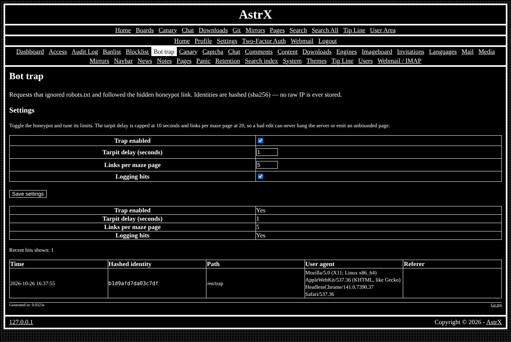

# astrx/module-bottrap

Honeypot link and labyrinth that catches crawlers ignoring robots rules — the **Bot trap** module of [AstrX](https://github.com/Vxmdzhb/astrx).



- Module key: `bottrap` (switch it on in the site's `resources/config/Modules.config.php`)
- Pages: `admin_trap`, `bot_trap`
- Requires: `astrx/auth`, `astrx/cms`, `astrx/config`, `astrx/csrf`, `astrx/http`, `astrx/i18n`, `astrx/kernel`, `astrx/module`, `astrx/result`, `astrx/routing`, `astrx/session`, `astrx/support`, `astrx/template`

It ships its own templates, catalogs (en, it), default configuration and SQL in
`resources/`; the site overrides any of them from its own `resources/`.

AstrX isn't on Packagist and doesn't tag versions: you install from each
repository's `main`, and your `composer.lock` pins the exact commit. Tell
Composer where to find the package and the AstrX packages it depends on:

```json
{
    "minimum-stability": "dev",
    "prefer-stable": true,
    "repositories": [
        { "type": "vcs", "url": "https://github.com/Vxmdzhb/module-bottrap" },
        { "type": "vcs", "url": "https://github.com/Vxmdzhb/result" },
        { "type": "vcs", "url": "https://github.com/Vxmdzhb/support" },
        { "type": "vcs", "url": "https://github.com/Vxmdzhb/config" },
        { "type": "vcs", "url": "https://github.com/Vxmdzhb/auth" },
        { "type": "vcs", "url": "https://github.com/Vxmdzhb/api" },
        { "type": "vcs", "url": "https://github.com/Vxmdzhb/http" },
        { "type": "vcs", "url": "https://github.com/Vxmdzhb/i18n" },
        { "type": "vcs", "url": "https://github.com/Vxmdzhb/session" },
        { "type": "vcs", "url": "https://github.com/Vxmdzhb/kernel" },
        { "type": "vcs", "url": "https://github.com/Vxmdzhb/routing" },
        { "type": "vcs", "url": "https://github.com/Vxmdzhb/template" },
        { "type": "vcs", "url": "https://github.com/Vxmdzhb/captcha" },
        { "type": "vcs", "url": "https://github.com/Vxmdzhb/csrf" },
        { "type": "vcs", "url": "https://github.com/Vxmdzhb/error-handler" },
        { "type": "vcs", "url": "https://github.com/Vxmdzhb/identicon" },
        { "type": "vcs", "url": "https://github.com/Vxmdzhb/image" },
        { "type": "vcs", "url": "https://github.com/Vxmdzhb/mail" },
        { "type": "vcs", "url": "https://github.com/Vxmdzhb/injector" },
        { "type": "vcs", "url": "https://github.com/Vxmdzhb/module" },
        { "type": "vcs", "url": "https://github.com/Vxmdzhb/pagination" },
        { "type": "vcs", "url": "https://github.com/Vxmdzhb/cms" }
    ]
}
```

Then:

```sh
composer require astrx/module-bottrap:dev-main
```

After that, list `AstrX\BotTrap\BotTrapModule::class` in the
site's `ApplicationModules::INSTALLED` and run the installer to create its
tables. See [modules](https://github.com/Vxmdzhb/astrx/blob/main/docs/MODULES.md).

Issues and pull requests are welcome here. [AstrX](https://github.com/Vxmdzhb/astrx)
is the site that puts all the packages together.

## License

Released under the [Do Whatever License](LICENSE), with a code of conduct
in the same spirit: [CODE_OF_CONDUCT](CODE_OF_CONDUCT).
